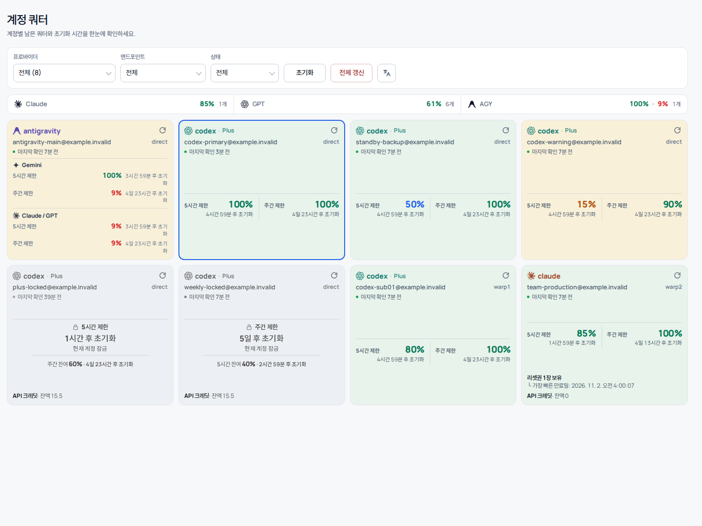
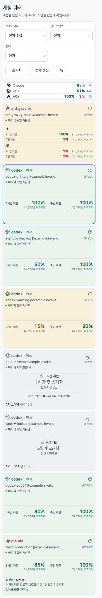

<p align="center"><a href="README.md">English</a> · <b>한국어</b></p>

<div align="center">
  <h1>cliproxyapi-plugin-quota-monitor</h1>
  <p>CLIProxyAPI를 위한 공급자 계정 쿼터·크레딧 모니터링 및 반응형 대시보드(한국어/영어) 네이티브 Go 플러그인.</p>

  <p>
    <a href="https://go.dev" target="_blank" rel="noreferrer"></a>
    <a href="https://github.com/dohwi/cliproxyapi-plugin-quota-monitor/actions/workflows/verify.yml" target="_blank" rel="noreferrer"></a>
    <a href="LICENSE" target="_blank" rel="noreferrer"></a>
  </p>

  <p><a href="#preview">Preview</a> · <a href="#features">Features</a> · <a href="#getting-started">Getting Started</a> · <a href="#routes">Routes</a> · <a href="#language">Language</a> · <a href="docs/contract.md">Contract</a></p>
</div>

---

## Overview

`cliproxyapi-plugin-quota-monitor`는 CLIProxyAPI 호스트에 직접 로드되는 `c-shared` C ABI 기반 네이티브 Go 플러그인입니다. 등록된 AI 공급자 계정들의 잔여 한도, 리셋 주기, 활성/비활성 상태, 사용 가능한 크레딧 잔액을 주기적으로 안전하게 수집하고, 독립적인 임베디드 반응형 대시보드 및 관리 API를 제공합니다.

## Preview

| Desktop Dashboard | Mobile View |
| :---: | :---: |
|  |  |

## Features

- **계정별 쿼터 및 크레딧 추적**: Claude, Codex, Antigravity 등 주요 공급자 계정의 윈도우별 잔여 퍼센트, 리셋 예정 시각, 크레딧 잔액 모니터링.
- **최근 사용 계정 강조**: 프록시를 통해 최근 실제로 트래픽을 처리한 계정을 시각적으로 구분 표시.
- **제약적 수집기 (Bounded Collection)**: 계정별 조회 일정, 단일 백그라운드 수집 워커, 타임아웃 및 동시성 제어로 공급자 API 과부하 방지.
- **갱신 일관성 보호 (Refresh Consistency)**: 오래된 비동기 조회가 최신 갱신 데이터를 덮어쓰지 않도록 세대 기반 캐시 관리.
- **자립형 반응형 대시보드**: 외부 CDN이나 무거운 차트 라이브러리 없이 순수 HTML/CSS/JS 및 자체 호스팅 WOFF2 글꼴(SUIT, Manrope)로 렌더링.
- **한국어/영어 UI**: 대시보드 헤더에서 언어를 전환합니다([Language](#language) 참고).
- **인증된 데이터, 정적 셸**: 인증 없는 `/v0/resource` 경로에는 페이지와 글꼴만 두고, 쿼터 데이터와 명시적 갱신(30초 전역 쿨다운)은 관리 키가 있어야 합니다([보안](SECURITY.md) 참고).

## Tech Stack

| Domain | Technology / Specification |
|---|---|
| Runtime & ABI | Go 1.26.9, cgo, C shared library (`.so` / `.dylib` / `.dll`) |
| Host Integration | CLIProxyAPI Plugin C ABI (`v0` management/resource routes) |
| Embedded UI | HTML5, Vanilla JavaScript, CSS Grid/Flexbox |
| Bundled Typography | SUIT Regular/SemiBold, Manrope Variable (self-hosted WOFF2) |
| Verification | Go race/vet, Node 레이아웃·i18n·인증 게이트 테스트, 모든 플랫폼의 Native C smoke test (`dlopen` / `LoadLibrary`) |

## Getting Started

플러그인은 CGO `c-shared` 라이브러리이므로 대상 플랫폼(Linux, macOS, Windows · amd64/arm64)에서 C 컴파일러(gcc 또는 clang)로 직접 빌드해야 합니다.

[mise](https://mise.jdx.dev)를 통해 로컬 런타임을 간편하게 부트스트랩할 수 있습니다:

```bash
# Managed runtimes
mise trust
mise install

# 네이티브 빌드 도구: Ubuntu/Debian
sudo apt-get update && sudo apt-get install -y build-essential
# macOS: xcode-select --install      Windows: 64비트 mingw-w64 gcc(예: MSYS2 UCRT64)와 Git Bash

# 테스트와 네이티브 ABI 스모크 테스트 (make가 없는 환경에서도 스크립트로 실행 가능)
make verify
scripts/build-native.sh
```

### Build

```bash
make build
```

빌드 결과물은 `artifacts/quota-monitor.so`(macOS는 `.dylib`, Windows는 `.dll`)와 해당 헤더 파일로 생성됩니다.

## Install

[CLIProxyAPI Plugins Store](https://github.com/router-for-me/CLIProxyAPI-Plugins-Store)에 등록되면 호스트의 플러그인 페이지에서 `quota-monitor`를 설치할 수 있습니다. 수동 설치는 [최신 릴리스](https://github.com/dohwi/cliproxyapi-plugin-quota-monitor/releases/latest)에서 `quota-monitor_<version>_<os>_<arch>.zip`과 `checksums.txt`를 받아 `sha256sum -c checksums.txt`(macOS는 `shasum -a 256 -c`)로 확인한 뒤, 라이브러리를 호스트의 플러그인 디렉터리에 풉니다.

모든 릴리스는 스토어가 요구하는 5개 플랫폼을 함께 게시합니다. Release 워크플로는 5개가 모두 빌드되고 네이티브 스모크 테스트를 통과해야만 게시합니다.

| 플랫폼 | 에셋 | 라이브러리 |
|---|---|---|
| Linux x64 | `quota-monitor_<version>_linux_amd64.zip` | `quota-monitor.so` |
| Linux arm64 | `quota-monitor_<version>_linux_arm64.zip` | `quota-monitor.so` |
| macOS Intel | `quota-monitor_<version>_darwin_amd64.zip` | `quota-monitor.dylib` |
| macOS Apple silicon | `quota-monitor_<version>_darwin_arm64.zip` | `quota-monitor.dylib` |
| Windows x64 | `quota-monitor_<version>_windows_amd64.zip` | `quota-monitor.dll` |

Linux 빌드는 glibc 2.36 이하(공식 Debian bookworm 이미지)가 필요합니다.

### 릴리스

`internal/plugin/plugin.go`의 `pluginVersion`을 올려 병합한 뒤 같은 버전의 태그를 푸시합니다.

```bash
git tag v0.2.0 && git push origin v0.2.0
```

태그는 `pluginVersion`과 일치하는 점 구분 숫자 버전(`vX.Y.Z`)이어야 합니다. 워크플로가 플랫폼별 네이티브 러너에서 빌드해 `<id>_<version>_<os>_<arch>.zip`으로 패키징하고, `checksums.txt`를 만들어 GitHub 릴리스를 생성합니다.

## Language

대시보드는 한국어와 영어를 지원하며, 필터 영역의 번역 아이콘 버튼 하나를 누를 때마다 한국어와 영어가 전환되며, 툴팁에 전환될 언어가 표시됩니다.

- **선택 순서**: 저장된 선택 → 브라우저 언어(한국어면 한국어, 그 외는 영어) → 한국어.
- **공유 설정**: 선택값은 브라우저의 `cpa_plugin_lang` 키에 저장되며, [usage-audit](https://github.com/dohwi/cliproxyapi-plugin-usage-audit) 대시보드와 같은 키를 씁니다. 한쪽에서 바꾸면 열려 있는 다른 쪽도 따라갑니다. 두 대시보드가 같은 origin에서 제공될 때만 적용됩니다.
- **개인정보**: 언어 키가 페이지가 `localStorage`에 쓰는 유일한 값입니다. 관리 키는 현재 탭의 `sessionStorage`에만 보관되며 `localStorage`, 쿠키, URL에는 쓰이지 않습니다.
- **번역되지 않는 항목**: 호스트 메뉴에 표시되는 플러그인 이름은 로드 시 한 번 등록되므로 한국어("계정 쿼터")로 유지됩니다.

## Routes

CLIProxyAPI 호스트 로드 후 아래 경로로 접근할 수 있습니다. 인증 없이 열리는 것은 정적 셸뿐이며 모든 데이터는 관리 키가 필요합니다:

| Method | Route | Description |
|---|---|---|
| `GET` | `/v0/resource/plugins/quota-monitor/dashboard` | 반응형 대시보드 페이지 (정적 셸, 데이터 없음) |
| `GET` | `/v0/management/plugins/quota-monitor/data/accounts` | 대시보드용 계정 쿼터 스냅샷 (조회 유발 없음) |
| `POST` | `/v0/management/plugins/quota-monitor/data/refresh?confirm=1` | 전체 또는 `account_key` 하나의 명시적 갱신 (30초 쿨다운) |
| `GET` | `/v0/management/plugins/quota-monitor/accounts` | 전체 계정 스냅샷 (관리 API) |
| `POST` | `/v0/management/plugins/quota-monitor/refresh` | 강제 갱신 |
| `GET` | `/v0/management/plugins/quota-monitor/status` | 수집기 상태 및 통계 |
| `GET` | `/v0/management/plugins/quota-monitor/dashboard` | 관리 경로의 동일 대시보드 페이지 |

## Project Structure

```text
cliproxyapi-plugin-quota-monitor/
├── main.go                 # c-shared C ABI 엔트리포인트 (plugin.register, management routes)
├── internal/
│   ├── quota/              # 공급자별 쿼터 클라이언트, 파서 및 도메인 모델
│   ├── plugin/             # 플러그인 수명주기, 수집 스케줄러, 스냅샷, 핸들러
│   ├── authdir/            # CLIProxyAPI auth-dir 파서
│   ├── availability/       # 공급자 패밀리별 가용성 평가
│   ├── overview/           # 공급자별 보수적 쿼터 요약
│   └── dashboard/          # 내장 대시보드: dashboard.html, style.css, app.js, 폰트 에셋
├── docs/                   # 프로토콜 계약, 관리 명세 및 이미지
├── scripts/                # 릴리스 패키징, 네이티브 빌드, 대시보드 검증 스크립트
├── verification/           # 크로스 플랫폼 네이티브 C ABI 스모크 테스트 (dlopen / LoadLibrary)
├── Makefile                # 빌드, 검증, 스모크 테스트 타겟
└── THIRD_PARTY_NOTICES.md  # 번들 폰트 라이선스 고지
```

대시보드 소스는 `internal/dashboard/`의 일반 파일 3개이며, `go:embed`로 포함되어 시작 시 단일 자립형 페이지로 조립됩니다.

## Documentation

- [Plugin Contract](docs/contract.md): C ABI, 리소스 및 릴리스 계약
- [Management Contract](docs/management.md): 설정 및 관리 라우트 상세
- [Remaining API](docs/remaining-api.md): 스냅샷 및 갱신 API 명세
- [Collection Contract](docs/collection-contract.md): 백그라운드 수집 및 보안 정책

## License

[MIT](LICENSE) — 저작권 및 라이선스 고지를 유지하면 상업적 이용을 포함해 자유롭게 사용·수정·배포할 수 있습니다.

## Security & Attribution

- 키, OAuth 토큰, 실제 계정 자격증명은 저장소에 커밋하지 않습니다.
- 내장 대시보드 번들 폰트 출처 및 라이선스는 [THIRD_PARTY_NOTICES.md](THIRD_PARTY_NOTICES.md)를 참고하세요.
