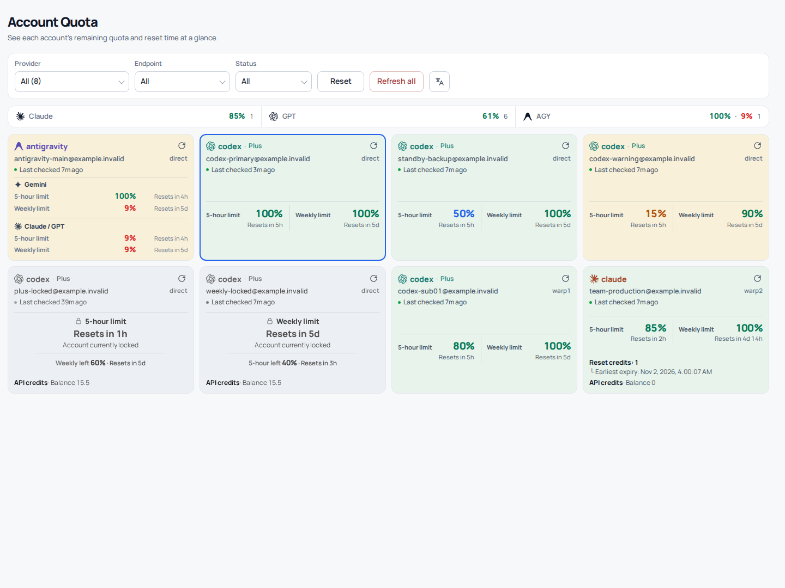
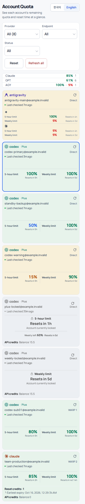

<p align="center"><b>English</b> · <a href="README.ko.md">한국어</a></p>

<div align="center">
  <h1>cliproxyapi-plugin-quota-monitor</h1>
  <p>A native Go plugin for CLIProxyAPI that monitors provider account quotas and credits, with a responsive bilingual (English/Korean) dashboard.</p>

  <p>
    <a href="https://go.dev" target="_blank" rel="noreferrer"></a>
    <a href="https://github.com/dohwi/cliproxyapi-plugin-quota-monitor/actions/workflows/verify.yml" target="_blank" rel="noreferrer"></a>
    <a href="LICENSE" target="_blank" rel="noreferrer"></a>
  </p>

  <p><a href="#preview">Preview</a> · <a href="#features">Features</a> · <a href="#getting-started">Getting Started</a> · <a href="#routes">Routes</a> · <a href="#language">Language</a> · <a href="docs/contract.md">Contract</a></p>
</div>

---

## Overview

`cliproxyapi-plugin-quota-monitor` is a `c-shared` C ABI native Go plugin that the CLIProxyAPI host loads directly. It periodically and safely collects the remaining quota, reset schedule, active/disabled state and available credit balance of your registered AI provider accounts, and serves them through a self-contained responsive dashboard and a management API.

## Preview

| Desktop Dashboard | Mobile View |
| :---: | :---: |
|  |  |

## Features

- **Per-account quota and credit tracking**: remaining percentage per window, reset time and credit balance for Claude, Codex, Antigravity and other providers.
- **Recently used account highlight**: visually marks the account that most recently handled traffic through the proxy.
- **Bounded collection**: per-account probe schedule, a single background worker, timeouts and concurrency limits keep provider APIs from being overloaded.
- **Refresh consistency**: generation-based cache management stops a stale asynchronous probe from overwriting newer data.
- **Self-contained responsive dashboard**: plain HTML/CSS/JS with self-hosted WOFF2 fonts (SUIT, Manrope). No CDN and no chart library.
- **Bilingual UI**: English and Korean, switchable from the dashboard header (see [Language](#language)).
- **Authenticated data, static shell**: the unauthenticated `/v0/resource` prefix serves only the page and fonts; quota data and the explicit refresh (30-second global cooldown) require the management key (see [Security](SECURITY.md)).

## Tech Stack

| Domain | Technology / Specification |
|---|---|
| Runtime & ABI | Go 1.26.9, cgo, C shared library (`.so` / `.dylib` / `.dll`) |
| Host Integration | CLIProxyAPI Plugin C ABI (`v0` management/resource routes) |
| Embedded UI | HTML5, Vanilla JavaScript, CSS Grid/Flexbox |
| Bundled Typography | SUIT Regular/SemiBold, Manrope Variable (self-hosted WOFF2) |
| Verification | Go race/vet, Node layout, i18n and auth-gate tests, native C smoke test (`dlopen` / `LoadLibrary`) on every platform |

## Getting Started

The plugin is a CGO `c-shared` library, so build it natively on the platform you target (Linux, macOS or Windows; amd64 or arm64) with a C compiler (gcc or clang).

Bootstrap the local runtimes with [mise](https://mise.jdx.dev):

```bash
# Managed runtimes
mise trust
mise install

# Native build tools: Ubuntu/Debian
sudo apt-get update && sudo apt-get install -y build-essential
# macOS: xcode-select --install      Windows: 64-bit mingw-w64 gcc (e.g. MSYS2 UCRT64) and Git Bash

# Run tests and the native ABI smoke test (the script also works where make is missing)
make verify
scripts/build-native.sh
```

### Build

```bash
make build
```

The build writes `artifacts/quota-monitor.so` (`.dylib` on macOS, `.dll` on Windows) and the matching header.

## Install

Once listed in the [CLIProxyAPI Plugins Store](https://github.com/router-for-me/CLIProxyAPI-Plugins-Store), install `quota-monitor` from the host's plugin page. To install manually, download `quota-monitor_<version>_<os>_<arch>.zip` and `checksums.txt` from the [latest release](https://github.com/dohwi/cliproxyapi-plugin-quota-monitor/releases/latest), verify with `sha256sum -c checksums.txt` (`shasum -a 256 -c` on macOS), and unzip the library into the host's plugin directory.

Every release publishes all five store platforms; the Release workflow refuses to publish unless all of them built and passed the native smoke test:

| Platform | Asset | Library |
|---|---|---|
| Linux x64 | `quota-monitor_<version>_linux_amd64.zip` | `quota-monitor.so` |
| Linux arm64 | `quota-monitor_<version>_linux_arm64.zip` | `quota-monitor.so` |
| macOS Intel | `quota-monitor_<version>_darwin_amd64.zip` | `quota-monitor.dylib` |
| macOS Apple silicon | `quota-monitor_<version>_darwin_arm64.zip` | `quota-monitor.dylib` |
| Windows x64 | `quota-monitor_<version>_windows_amd64.zip` | `quota-monitor.dll` |

The Linux builds require glibc 2.36 or older (the official Debian bookworm image).

### Releasing

Bump `pluginVersion` in `internal/plugin/plugin.go`, merge, then push a matching tag:

```bash
git tag v0.2.0 && git push origin v0.2.0
```

The tag must match `pluginVersion` and be a dotted numeric version (`vX.Y.Z`); the workflow builds each platform on a native runner, packages `<id>_<version>_<os>_<arch>.zip`, writes `checksums.txt` and creates the GitHub release.

## Language

The dashboard ships in English and Korean. A single translate icon button in the filter area switches between Korean and English; its tooltip names the language it switches to.

- **Selection order**: saved choice, then browser language (Korean selects Korean, anything else selects English), then Korean.
- **Shared setting**: the choice is stored in the browser under `cpa_plugin_lang`, the same key used by the [usage-audit](https://github.com/dohwi/cliproxyapi-plugin-usage-audit) dashboard. Changing it in one open dashboard updates the other. This only applies when both dashboards are served from the same origin.
- **Privacy**: the language key is the only thing the page writes to `localStorage`. The management key is held in `sessionStorage` for the current tab only and is never written to `localStorage`, cookies or a URL.
- **Not translated**: the plugin name shown in the host menu is registered once at load time, so it stays Korean ("계정 쿼터").

## Routes

Once the CLIProxyAPI host has loaded the plugin, these routes are available. Only the static shell is unauthenticated; all data requires the management key:

| Method | Route | Description |
|---|---|---|
| `GET` | `/v0/resource/plugins/quota-monitor/dashboard` | Responsive dashboard page (static shell, no data) |
| `GET` | `/v0/management/plugins/quota-monitor/data/accounts` | Sanitized quota snapshot for the dashboard (never triggers a probe) |
| `POST` | `/v0/management/plugins/quota-monitor/data/refresh?confirm=1` | Explicit refresh of all accounts or one `account_key` (30-second cooldown) |
| `GET` | `/v0/management/plugins/quota-monitor/accounts` | Full account snapshot (management API) |
| `POST` | `/v0/management/plugins/quota-monitor/refresh` | Forced refresh |
| `GET` | `/v0/management/plugins/quota-monitor/status` | Collector status and statistics |
| `GET` | `/v0/management/plugins/quota-monitor/dashboard` | The same dashboard page on the management path |

## Project Structure

```text
cliproxyapi-plugin-quota-monitor/
├── main.go                 # c-shared C ABI entry point (plugin.register, management routes)
├── internal/
│   ├── quota/              # Per-provider quota clients, parsers and domain models
│   ├── plugin/             # Plugin lifecycle, collection scheduler, snapshots, handlers
│   ├── authdir/            # CLIProxyAPI auth-dir parser
│   ├── availability/       # Per-provider-family availability evaluation
│   ├── overview/           # Conservative per-provider quota summary
│   └── dashboard/          # Embedded dashboard: dashboard.html, style.css, app.js, font assets
├── docs/                   # Protocol contract, management spec and images
├── scripts/                # Release packaging, native build and dashboard verification scripts
├── verification/           # Cross-platform native C ABI smoke test (dlopen / LoadLibrary)
├── Makefile                # Build, verify and smoke-test targets
└── THIRD_PARTY_NOTICES.md  # Bundled font license notices
```

The dashboard source is three plain files in `internal/dashboard/`. They are embedded with `go:embed` and assembled into one self-contained page at start-up.

## Documentation

- [Plugin Contract](docs/contract.md): C ABI, resource and release contract
- [Management Contract](docs/management.md): configuration and management route details
- [Remaining API](docs/remaining-api.md): snapshot and refresh API specification
- [Collection Contract](docs/collection-contract.md): background collection and security policy

## License

[MIT](LICENSE). You may use, modify, distribute and sell this software, including commercially, as long as the copyright and license notice are kept.

## Security & Attribution

- Keys, OAuth tokens and real account credentials are never committed to this repository.
- Bundled dashboard fonts and their licenses are listed in [THIRD_PARTY_NOTICES.md](THIRD_PARTY_NOTICES.md).
